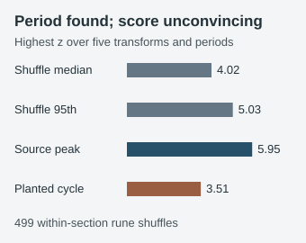

# Does a periodic signal survive transformations of LP2?

**Finding.** A previously reported peak reproduces: in the pinned LP2 pages 27–32 transcription, taking each rune minus the rune two places earlier gives a normalized coincidence score of **1.412** at period **238**. That is the highest score in this source profile. It is an observation about this transform and transcription, not a recovered key.



The harder question is whether the scoring rule reliably points to a periodic source. We scanned the source's five representations—original runes, neighboring differences, neighboring sums, two-step differences and nonzero neighboring ratios—over every eligible period through 300. In 499 shuffles of the same page group's runes, one shuffle reached or exceeded the real-data peak when we took the best result across all five representations and periods. The resulting **conditional** tail fraction is 2/500. Allowing for selection among the nine page groups gives a simple bound of 18/500. Neither calculation covers the separate concatenated-page scan, other statistics or earlier choices that led to this analysis.

Our frozen positive control makes the practical limit clear. We planted a strong 13-rune cycle, replacing 10% of its symbols at random. Its ordinary coincidence score at period 13 was **23.464**. The source's within-profile ranking selected period **143 = 11 × 13**, so the literal planned criterion of finding 13 or a multiple **passed**. Yet its maximum standardized score fell below **452 of the 499** shuffle maxima. This score alone would not distinguish that known periodic source from its shuffle controls. The real period-238 peak should not be treated as evidence that the manuscript has a 238-rune encryption cycle.

## What was measured

We used the nine unsolved text sections and alphabet from the pinned [relikd transcription](https://github.com/relikd/LiberPrayground/tree/719380ebee0523ad7f2fbf389c6f960d51bea5a4). The operator and unweighted average over residue-column coincidence scores follow [Leo's test](https://github.com/Leo-Y-Zhang/LiberPrimusAnalysis/blob/a32bdc0e06ea58532fbaf4329acae4a0b1020513/tests3.py). The complete profile also records repeated four-rune spacing, visible word-edge counts and a separate all-section concatenation. Those additional scans are descriptive; the shuffle fraction above is conditional on the pages 27–32 scan only.

At period 238, a 1,431-symbol two-step-difference stream leaves only six or seven symbols per residue column. That makes an unusually high average sensitive to small-column coincidences. The source reports this peak as about 1.412 and z 6.0; the independent replay gives 1.412285 and z 5.950736 before rounding.

## Reproduce

Obtain the pinned relikd checkout. From the repository root, substitute its path for `PATH`:

```text
python experiments/records/leo-transform-periodic-profile/run.py --source-root PATH --check
python experiments/records/leo-transform-periodic-profile/check.py --source-root PATH
```

The first command recomputes the nine section profiles and all 499 shuffles from the source bytes. The second independently checks the source hashes, the full pages 27–32 period profile, visible word edges and control arithmetic without importing the producer. Exact source text is linked rather than redistributed here. Neither command tests a decryption or rules out periodic ciphers.
