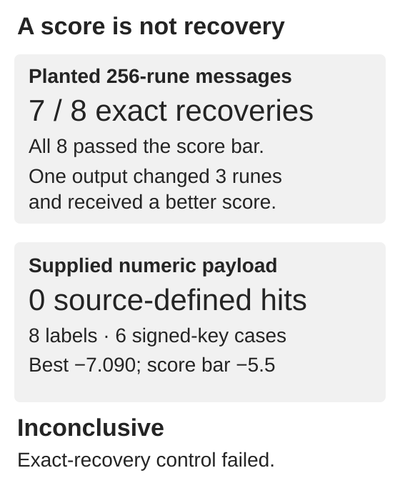

# Using LP2 as a key for the 256-byte payload

None of the eight tested settings reached the English-score threshold for the 256-byte payload from pages 49–51. **This is inconclusive:** the decoder also changed three runes in one of eight planted messages, despite giving that wrong output a better English score. The work adds a missing target to an earlier search. It does not establish a reading or rule out using LP2 as a key.

## What was tested

The [original five-target search](#/experiments/public-lp2-as-pad) used the unsolved LP2 stream as a running key for other Cicada objects. Its F-01 source skipped the pp49–51 payload because the expected `payload.bin`, `payload.hex` and `payload_bytes.json` were absent. This follow-up supplies the separate committed `canon_256.bin` at the first loader path. Those bytes are authenticated against the pinned commit, **not identified as the unavailable historical payload.bin**.

Each byte is reduced modulo 29. The key is the same 12,956-rune source stream: forward, reversed, Atbash or negated, each with either sign. The unchanged decoder starts at key offset zero, permits at most three conditionally admissible skipped key positions per rune, and retains a beam of 400 paths. Eight labels represent six effective signed-key transformations: forward/+ equals negated/−, and forward/− equals negated/+. Atbash is distinct. This adds one bounded target to the existing method, not eight independent ideas.

## Controls and the pre-target amendment

The original source plant passes its declared gate, including at least 80% character recovery; it is recovered exactly. A separately frozen, stronger control repeats that same source message to 256 runes and plants it under every key/sign setting. All eight exceed the source score bar, but only seven recover every rune. Reversed-key/+ returns 253 of 256 correct runes. Positions 24–26 are changed from O, T, I to A, L, E.

The [independent control audit](control-failure-audit.json) finds the true path admissible and retained to the end, ranked second. The selected wrong path has strictly better cumulative and normalized scores; this is neither a tie nor a pruned true path. The source’s 80% character gate and the new exact-rune gate are different tests.

The [original frozen plan](preflight-plan-frozen.json) required exact recovery before interpreting a negative target result. That gate failed and remains failed. A separate [dated amendment written before target decoding](diagnostic-amendment-before-target.json) authorized the unchanged target calls as diagnostic source completion only. No beam, text, seed or threshold was adjusted.

## Saved target results

Every new setting returns 256 runes. The source-selected best is forward/− (and its negated/+ alias), normalized score **−7.090111**, below the **−5.5** source threshold. The [complete results](target-results.json) contain all eight full output arrays and scores.

All 40 original primary rows were first reproduced exactly. The original stable selection over the combined 48 labels then picks two old first-target aliases, the two new payload aliases and one old solved-LP1 setting. The three old null receipts are reused. The two new aliases share the same 200 target-order shuffles: 200 actual new null decodes, representing 400 labelled comparisons. None of the five selected rows passes the source’s joint score and null-margin rule. This selected-panel comparison is not a calibrated probability for the whole search.

The [independent target audit](independent-target-audit.json) recomputes all eight scores directly from raw quadgram counts, reconstructs admissible skipped-key paths, and checks aliases, stable ranking and null arithmetic. A separate post-target inspection of the best new case’s 400 retained terminal paths finds a higher normalized score at cumulative rank 22 (−7.049147), still below −5.5. This diagnostic does not replace the historical source-selected output or audit every terminal beam from every setting.

## Limits and saved results

A score is not plaintext confirmation. The failed exact-recovery control prevents a power-validated rejection of the key model. Other payload bytes, offsets, skip models and encodings remain outside scope. The old 63-byte hard-coded AN END input is preserved exactly; its provenance is not repaired here.

Saved outputs answer which fixed settings the source selected, their complete rune arrays and their selected shuffled-target comparisons without rerunning. They cannot establish readable English, recover missing historical payload bytes, or exclude other key models.

## Reproduce

The bundle contains the pinned MIT-licensed source, exact payload bytes, frozen plans, original results and independent checks. [PORTABILITY.md](PORTABILITY.md) gives extraction-root commands. `run.py` performs fresh controls and the complete diagnostic target replay, then compares every deterministic field with the saved expectations. `check.py --check` is the separate quick saved-evidence audit. No API, model, download or external corpus is needed.
