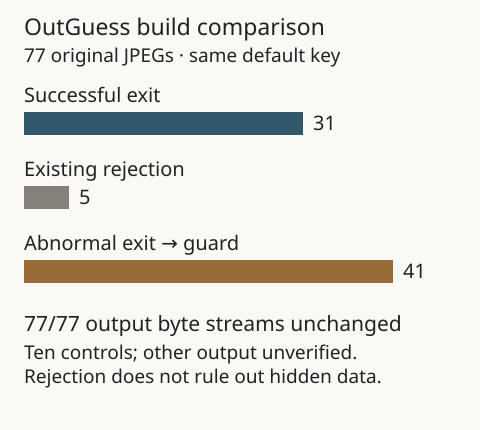

# Guarded OutGuess: full baseline comparison

This plan extends the 13-case diagnostic pilot to the complete original 77-image baseline. It retains all original image hashes, the literal default key and 20-second timeout. The ten known positive controls run first; a failed control stops the sweep. This is not a new key search or authentication of candidate output.

The executable is the recorded clean build in `../outguess-guard-pilot/clean-build-report.json`; its source build instructions are in that directory. The pilot cases are included, not treated as unseen validation.

Run from the repository root, with a new output directory:

```text
python experiments/records/outguess-guard-sweep/run.py --outguess /path/to/outguess.exe --output experiments/records/outguess-guard-sweep/results
```

Retain every output and diagnostic, including differences from the baseline. Compare payload bytes directly. Do not count an explicit guard rejection as proof that an image contains no hidden data. The original baseline executable is unmodified; a changed guarded diagnostic does not establish a baseline crash stack trace.

## Recorded result

The plan and runner were committed as `40890c5` before execution on 20 October 2026. All 77 retrievals completed within the declared limit. All ten controls matched their expected payload hashes.



| Baseline outcome | Guarded result | Images |
| --- | --- | ---: |
| Exit 0 | Exit 0; same diagnostic and bytes | 31 |
| Exit 1 | Exit 1; same diagnostic and bytes | 5 |
| Exit 3221225620 | Exit 1; explicit zero-iterator guard; same empty output | 41 |

The 31 successful exits comprise ten controls and 21 unverified outputs. Every one of the 41 changed cases reports `Guard: iterator skipmod zero`, with image-specific offsets and bit counts retained in the report. All 77 payload byte streams match the baseline exactly. There are no new candidate payloads in this comparison.

The guard detects a zero value before the patched iterator's remainder operation. This supports a specific explanation for the guarded runs. It is not an instrumented trace of the original executable, a test of other keys, or proof that no hidden data exists. Both builds share the same upstream source version and Windows port; this is not independent implementation or cross-platform validation. Human review remains pending.

## Audit without running OutGuess

```text
python experiments/records/outguess-guard-sweep/compare.py --check
python experiments/records/outguess-guard-sweep/figure.py
```

The checker verifies original image hashes, plan/report dependencies, saved payload sizes and hashes, then compares bytes and diagnostics directly against the saved baseline. It recomputes the comparison rather than accepting its boolean fields as evidence. It needs the repository's original images and baseline result files. The figure is derived from the saved comparison, so run the checker first.

This directory is a completed computational comparison awaiting integration into the experiment index and downloadable family bundle.
