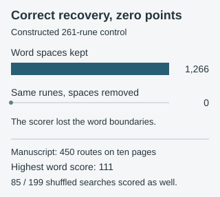

# Keyword decryption, then rearrange the runes

An archived program applies one proposed keyword to each of old pages 21–30 (current **LP2-04–13**), then tries **45 rearrangements per page**. These include prime and Fibonacci position extracts, column routes, reversals, sorting, and whole-word changes. This record replays that specific program; the [other keyword-and-route record](#/experiments/wulfic-keyed-transposition-cohort) tests a different source file.

**Finding:** The strongest source dictionary score on the manuscript is **111**, from reversing the rune order *inside each visible word* on LP2-10. Complete searches on **85 of 199** seeded shuffled versions of the same ten pages reached or exceeded 111. This score does not distinguish that output from the declared shuffle comparison, and no candidate is a validated reading.



The program's score also cannot rank most of its own routes meaningfully:

- **390 complete rune rearrangements** leave the page's rune counts and normalized coincidence unchanged. Rearrangement can change order, but it cannot by itself improve that frequency statistic.
- **50 whole-word ordering trials** merely rearrange the same decoded words. Their dictionary score is exactly the original score each time.
- **380 character-level outputs** are passed to the source word scorer as one unspaced string. All have word score zero on these ten pages, including the 60 shorter prime/Fibonacci extractions. Those shorter extracts do **not** share the full-page frequency invariant.

For a source-defined positive control, we built a complete **261-rune** wordlist message with the original LP2-04 visible word lengths, reversed it, and encrypted it under that page's assigned keyword. The reverse route recovers every rune exactly. With spaces, the source wordlist gives the message a score of **1,266**; the same recovered runes passed through that route's unspaced scoring path get **zero**. Thus a zero score on a character route cannot exclude a multiword plaintext. This engineered message is intentionally easy for the wordlist and is a scoring control, not a manuscript reading.

The old source labels and page mapping were checked against the current rune transcriptions. The original, unchanged script was run with its committed page and wordlist files staged under its legacy relative paths. The [results](results.json) retain all **450** source route rows and each of the **199** complete shuffled-search maxima. The 199 shuffles are a descriptive, retrospective selection comparison, not a cipher model or a probability that the manuscript is random.

The keyword choices remain proposals. No arbitrary keywords, different word boundaries, alternate source translations or unlisted routes are covered. This replay exposes what the archived program measured; it does not settle whether any rearrangement of LP2 is useful.

## Reproduce

The [plan](plan.json) pins the source revision, each input Git blob, the page mapping, route set and shuffle rule. The upstream program and 3.8 MB wordlist are not redistributed here; obtain the pinned [source revision](https://github.com/Wulfic/Cicada3301-Liber_Primus/blob/bf89d3d13aad2b8f2c95ab195cf1b092f250775c/tools/legacy/p21_30_rearrange.py) as a sibling `source-archives/Wulfic-Cicada3301-Liber_Primus` checkout or pass `--source-root` to the runner. The independent checker uses the same pinned Git blobs and reconstructs all 45 routes without calling the source route functions.

```sh
python experiments/records/wulfic-p21-rearrangement-routes/run.py --source-root PATH_TO_PINNED_CHECKOUT --check
python experiments/records/wulfic-p21-rearrangement-routes/check.py --source-root PATH_TO_PINNED_CHECKOUT
python experiments/records/wulfic-p21-rearrangement-routes/plot.py --check
```

The [unaltered source output](source-log.txt) is included as a short execution receipt.
