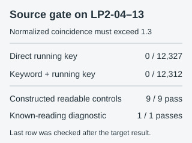

# Two running-key searches on LP2-04–13

The archived program tried two ways to use a passage of **Deor** or Emerson's **Self-Reliance** as a key. In one, it applied the passage directly to the page runes. In the other, it combined each passage rune with that page's assigned keyword rune first. It sampled offsets across each key text and tried three ways to combine key and ciphertext values modulo 29.

**Result:** None of the **24,639** source-defined settings passed the program's first screen: the decoded page had to have normalized rune index of coincidence **above 1.3**. The program therefore did not reach its wordlist ranking step on any of these pages. Running the unmodified pinned script on its exact committed inputs printed “No results with IoC > 1.3” for all ten source pages. The ten source rune streams match current LP2-04–13 rune for rune.



The direct branch checked **12,327** page, offset and mode settings; the keyword-plus-running-key branch checked **12,312**. Their highest normalized coincidence values were **1.148** and **1.173**, below the 1.3 gate. Repeating the full search on **49** seeded shuffles, each of which shuffled every page once and shared that shuffled corpus across all settings, also produced no passing candidate. That control gives no evidence that the gate distinguished the actual pages from these shuffles.

## What the control shows

Nine constructed full-page messages, using the source page's word lengths and the source wordlist, were encrypted and recovered exactly under all three direct modes and six layered modes. All nine cleared the coincidence screen and received positive wordlist scores. The word score ranks passing outputs; it is not a second source acceptance gate. Selecting words from that dictionary also makes these controls unusually easy for its scorer.

After observing the target result, we ran three one-page language checks. The first used **Deor as both message and key**. Its correct setting ranked first, but this shared text makes the check too favorable. The second used Deor as message and Self-Reliance as key. Its intended Deor reading ranked **second**, while the alternative Self-Reliance reading ranked **first**:

```text
cipher = Deor + Self-Reliance  (mod 29)
cipher − Self-Reliance = Deor  (score 68)
cipher − Deor = Self-Reliance  (score 201)
```

For this additive rule, swapping plaintext and key leaves the same ciphertext. Both corpora can therefore produce plausible outputs from one planted cipher, and the higher English score alone cannot identify which text was intended as the key. We kept the rank-two control visible rather than hiding it.

The third check used **261 decoded runes from a documented LP1 reading**, independent of either key text, encrypted with Self-Reliance at offset zero. The complete message was recovered; its coincidence was **1.665**, its source word score **118**, and the correct setting ranked **first** in the same one-page candidate grid. This check shows the source screen can admit one real known-reading sequence under an imposed LP2-04 word skeleton. All three checks were devised **after** the manuscript result, so none is a pre-target estimate of power across other messages or pages.

## Scope and source

The source's old page labels 21–30 mean LP2-04–13 here. The source's data paths were stale after repository relocation; for the exact replay, we staged its **unchanged script and committed file bytes** under the relative paths it expects. The source's two corpora, wordlist, page files and script are each pinned by Git revision and SHA-256 in the [plan](plan.json). Its `range` steps sample roughly **200 direct offsets** and **100 layered offsets** per page and key text, rather than every possible offset. The range also excludes the endpoint where the remaining key text exactly fits the page. The second branch uses only its single assigned keyword per page.

This is a replay of a historical **search rule**, not evidence that running keys or layered keys are impossible. It does not test altered page segmentation, other translations or editions of the key texts, skipped key positions, other keyword assignments, or a decryption that fails the script's coincidence gate. Isolated wordlist matches would not by themselves establish a reading; here, no target candidate reached that stage.

## Reproduce

Use the pinned [source revision](https://github.com/Wulfic/Cicada3301-Liber_Primus/blob/bf89d3d13aad2b8f2c95ab195cf1b092f250775c/tools/legacy/p21_30_autokey_solver.py) as a sibling `source-archives/Wulfic-Cicada3301-Liber_Primus` checkout, or pass its path with `--source-root`. The runner verifies every needed Git blob and the ten site-page hashes before comparing any result. This record does not redistribute the upstream corpus or script.

```sh
python experiments/records/wulfic-p21-running-key-layers/run.py --source-root PATH_TO_PINNED_CHECKOUT
python experiments/records/wulfic-p21-running-key-layers/power.py --source-root PATH_TO_PINNED_CHECKOUT --check
python experiments/records/wulfic-p21-running-key-layers/check.py --source-root PATH_TO_PINNED_CHECKOUT
python experiments/records/wulfic-p21-running-key-layers/plot.py --check
```

The [results](results.json) contain the full grid counts, per-page best records and all 49 null-grid summaries. The [original-script output](source-log.txt) is retained for comparison. The three post-target controls have separate [first](power-addendum.json), [second](power-addendum-v2.json) and [known-reading](power-addendum-v3.json) receipts and plans.
